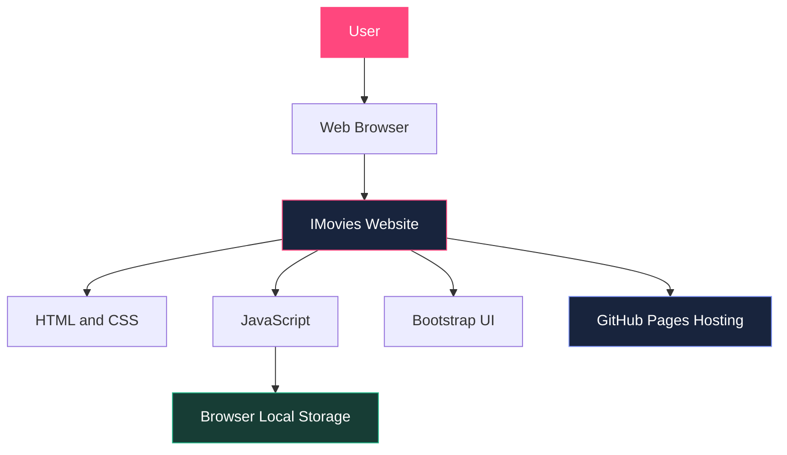
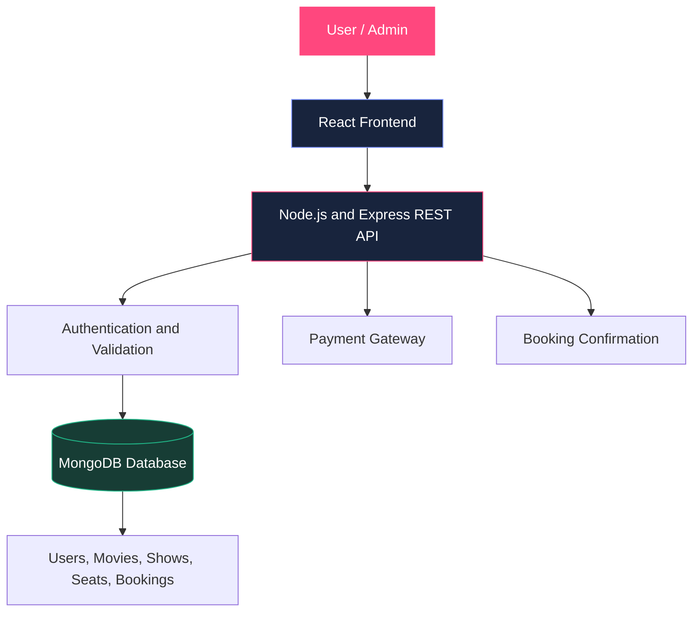

🎬 IMovies — Movie Ticket Booking Made Simple

**A modern, interactive movie ticket booking website built to make movie nights easier.**

🔗 **Live Demo:** https://achahat06-byte.github.io/IMovies-Movie-Ticket-Booking/

# Project Overview

IMovies is a cinema-themed movie ticket booking web application that allows users to explore movies, discover showtimes, select seats, and manage their bookings through an attractive and user-friendly interface.

The project focuses on providing a smooth browsing and booking experience with a responsive design and interactive features.

 ## Objectives

- Develop an intuitive online movie booking interface.
- Display movie information, genres, ratings, and ticket prices.
- Enable users to select seats and manage demo bookings.
- Provide watchlist and movie review features.
- Create a responsive, visually appealing cinema experience.

### Features

- 🎥 Movie listings and poster cards
- 🔎 Movie search and genre filters
- 🎟️ Interactive seat selection
- 📅 Show and booking selection
- 📋 Booking history and management
- ❤️ Watchlist and favorites
- ⭐ Movie ratings and reviews
- 📊 Demo administration dashboard
- 📱 Responsive layout
- 💾 Browser-based storage for supported demo data

# Technologies Used

- HTML5
- CSS3
- JavaScript
- Bootstrap
- Browser Local Storage
- GitHub and GitHub Pages

# How to Use

1. Open the live demo using the link above.
2. Browse the available movies.
3. Search for a movie or filter by genre.
4. Select a movie and choose the available show and seats.
5. Confirm the demo booking.
6. Explore your bookings, watchlist, and review features.


## 🏛️ System Architecture

### Current Implementation

The current version is a client-side web application hosted on GitHub Pages.



### Proposed Full-Stack Architecture

The following architecture represents the planned future expansion of IMovies.




## 🗄️ ER Diagram (Entity–Relationship Diagram)

The ER diagram represents the proposed database entities and their relationships for the complete IMovies booking system.


**Note:** This is a proposed relational database design. The current GitHub Pages demo does not implement this database or process real payments.


## Project Structure

```text
IMovies-Movie-Ticket-Booking/
├── index.html
└── README.md
```

## Project Limitations

This version is a front-end demonstration. Booking and favorite data are stored locally in the browser where supported. It does not provide a production backend, shared real-time seat availability, secure user authentication, or actual payment processing.

## Future Enhancements

- React-based frontend
- Node.js and Express REST API
- MongoDB database integration
- Secure authentication using JWT
- Shared seat availability and temporary seat locking
- Payment gateway integration
- Admin tools for managing movies and shows
- Booking confirmation notifications

## Deployment

The project is published using GitHub Pages.

## 📄 Conclusion

IMovies demonstrates the design and implementation of an interactive movie ticket booking interface, combining movie discovery, seat selection, booking management, and a modern cinema-inspired user experience.
